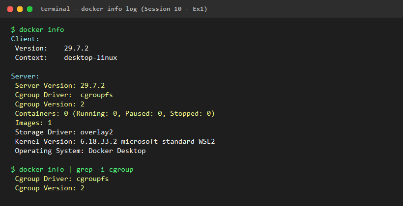

# BÁO CÁO KỸ THUẬT: PHÂN TÍCH KIẾN TRÚC CONTAINER VS VIRTUAL MACHINE (VM)

**Khóa học:** IT209 - Quản trị Hạ tầng & Công nghệ Đóng gói Ứng dụng  
**Bài tập:** Session 10 - Bài 1 (Ex1)  
**Tác giả:** Sinh viên thực hiện  
**Ngày lập báo cáo:** 12/10/2026  

---

## 1. Bối cảnh: Tại sao Doanh nghiệp Chuyển đổi từ VPS/VM sang Docker Container?

Trong kỷ nguyên chuyển đổi số và phát triển phần mềm hiện đại (Cloud Native, Microservices, CI/CD), các doanh nghiệp ngày càng chuyển dịch mạnh mẽ từ mô hình máy chủ ảo truyền thống (**VPS / Virtual Private Server / Virtual Machine**) sang nền tảng **Container (Docker / Kubernetes)**. 

Những lý do kỹ thuật cốt lõi thúc đẩy sự chuyển dịch này bao gồm:

1. **Tối ưu hóa Chi phí Hạ tầng & Tăng Mật độ Ứng dụng (Resource Density):**
   - Với VPS/VM, mỗi dịch vụ cần chạy trên một Hệ điều hành khách (Guest OS) riêng biệt, tiêu tốn cố định từ hàng trăm MB đến nhiều GB RAM chỉ để duy trì kernel và các tiến trình nền hệ thống của OS đó (systemd, journald, sshd, ...).
   - Với Docker Container, tất cả container đều chia sẻ chung một Linux Kernel của máy chủ Host. Điều này loại bỏ hoàn toàn chi phí trùng lặp cho Guest OS, cho phép chạy gấp 5-10 lần số lượng microservices trên cùng một cấu hình phần cứng so với VM.
2. **Loại bỏ lỗi "It works on my machine":**
   - Docker đóng gói toàn bộ mã nguồn, runtime, thư viện phụ thuộc (dependencies), biến môi trường và tệp cấu hình vào một Image chuẩn bất biến (immutable image). Ứng dụng đảm bảo thực thi giống hệt nhau trên máy lập trình viên (Development), môi trường kiểm thử (Staging) và môi trường thực tế (Production).
3. **Tăng tốc chu trình CI/CD và Khả năng Tự động Co giãn (Auto-scaling):**
   - Khởi động một VPS/VM mất từ 30 giây đến vài phút do phải trải qua chu trình nạp BIOS ảo, khởi động Kernel và kích hoạt toàn bộ services hệ thống.
   - Container khởi động chỉ trong vài phần trăm giây (sub-second) đến vài giây vì bản chất Container chỉ là một tiến trình (process) được cô lập khởi chạy trực tiếp trên Host Kernel. Nhờ vậy, quy trình CI/CD diễn ra tức thì và các hệ thống phân tán có thể scale tức thời khi lượng truy cập đột biến.

---

## 2. Bảng So sánh Chuyên sâu: Virtual Machine (VM) vs Docker Container

Dưới đây là bảng đối chiếu kỹ thuật chi tiết theo 5 tiêu chí bắt buộc:

| Tiêu chí | Virtual Machine (VM / Hypervisor) | Docker Container (OS-level Virtualization) |
| :--- | :--- | :--- |
| **1. Dung lượng Image (Image Size)** | **Rất lớn (Vài GB - Chục GB):** Image VM phải chứa toàn bộ Kernel của Guest OS, file hệ thống root, thư viện nền và các gói công cụ hệ điều hành đầy đủ (Ubuntu Server ~1.5GB+, Windows Server Core ~5GB+). | **Siêu nhẹ (Vài MB - Vài trăm MB):** Không chứa Kernel. Sử dụng các Base Image tối giản như Alpine Linux (~5-7MB) hoặc Scratch. Một backend Node.js hoàn chỉnh trên Alpine chỉ chiếm ~80-150MB. |
| **2. Thời gian khởi động (Startup Time)** | **Chậm (Vài chục giây đến vài phút):** Phải qua chu kỳ boot hoàn chỉnh: khởi động Hypervisor, nạp Guest OS Kernel, chạy init/systemd và nạp drivers thiết bị ảo. | **Gần như tức thì (Mili-giây đến vài giây):** Khởi chạy như một Linux process thông thường trên Host Kernel có sẵn, chỉ cần gọi `clone()` và `execve()`. |
| **3. Hao phí OS (OS Overhead)** | **Rất cao:** Hypervisor tiêu tốn tài nguyên quản lý CPU/Memory ảo. Mỗi VM chiếm dụng cố định 1-2GB RAM và một phần năng lực CPU cho Guest OS dù ứng dụng chưa có tải. | **Gần như bằng 0 (Zero Overhead):** Không có Hypervisor hay Guest OS trung gian. Các process container thực thi trực tiếp trên CPU và chia sẻ bộ nhớ của Host, hiệu năng đạt mức Bare-metal (native speed). |
| **4. Mức độ cô lập (Isolation Level)** | **Cực kỳ mạnh (Hardware-level Isolation):** Các máy ảo cô lập hoàn toàn ở tầng phần cứng thông qua Hypervisor. Sự cố kernel panic hay lỗ hổng bảo mật trong 1 VM không thể ảnh hưởng đến Host hoặc các VM khác. | **Cô lập ở tầng tiến trình (Process-level Isolation):** Sử dụng các tính năng Linux Kernel (Namespaces, cgroups, Seccomp, AppArmor). Nếu có lỗ hổng thoát quyền cấp hạt nhân (Kernel exploit), container có thể ảnh hưởng đến Host nếu không được cấu hình chặt chẽ (non-root user, dropped capabilities). |
| **5. Khả năng mở rộng (Scalability & Density)** | **Khó mở rộng quy mô lớn nhanh chóng:** Do overhead cao, việc scale-out (tạo thêm máy ảo) tốn nhiều thời gian và dung lượng đĩa cứng, số lượng máy ảo trên một host bị giới hạn nghiêm ngặt. | **Khả năng co giãn vượt trội (High Density & Elasticity):** Có thể khởi tạo hàng trăm đến hàng nghìn container trên một máy chủ vật lý duy nhất; tích hợp liền mạch với các hệ điều phối container (Kubernetes, Docker Swarm) để auto-scale linh hoạt. |

---

## 3. Bản chất Kỹ thuật: Cơ chế Cô lập Kernel trong Container

Một hiểu lầm phổ biến là xem Docker như một "máy ảo thu nhỏ". Về bản chất kỹ thuật, **Container thực chất là một tiến trình thông thường của Linux** nhưng được hạn chế góc nhìn (view) thông qua **Namespaces** và bị giới hạn tài nguyên thông qua **Control Groups (cgroups)**.

```
+----------------------------------------------------------------+
|                        DOCKER CONTAINER                        |
|   +--------------------------+    +------------------------+   |
|   |   Linux Namespaces       |    |   Control Groups       |   |
|   |   (Góc nhìn cô lập)      |    |   (Giới hạn phần cứng) |   |
|   | - PID (Tiến trình)       |    | - Giới hạn CPU (quota) |   |
|   | - NET (Mạng ảo, IP riêng)|    | - Giới hạn RAM (OOM)   |   |
|   | - MNT (Root Filesystem)  |    | - Giới hạn Disk I/O    |   |
|   | - IPC, UTS, USER         |    | - Giới hạn số PIDs     |   |
|   +--------------------------+    +------------------------+   |
+----------------------------------------------------------------+
                                |
             (Thực thi trực tiếp qua System Calls)
                                v
+----------------------------------------------------------------+
|                       SHARED HOST KERNEL                       |
|           (Linux Kernel 6.x / WSL2 / Bare-metal OS)            |
+----------------------------------------------------------------+
```

### 3.1. Vai trò của Linux Namespaces (Cô lập không gian danh mục)

Namespaces cung cấp cơ chế đóng gói các tài nguyên hệ thống toàn cục (global system resources) thành các phiên bản cục bộ, khiến cho tiến trình bên trong container có cảm giác nó đang sở hữu toàn bộ hệ thống độc lập:

1. **PID Namespace (Process ID):**
   - Cô lập cây tiến trình. Bên trong container, ứng dụng chính chạy với **PID = 1** (đóng vai trò là tiến trình gốc init, quản lý các tiến trình con và tín hiệu hệ thống như `SIGTERM`, `SIGINT`).
   - Ngoài Host OS, tiến trình này thực chất mang một PID thông thường (ví dụ: PID 32410). Nhờ vậy, container không thể nhìn thấy hoặc gửi tín hiệu can thiệp vào các tiến trình của máy chủ hoặc các container khác.
2. **NET Namespace (Network):**
   - Cung cấp cho container một hệ thống mạng hoàn chỉnh và độc lập: card mạng ảo riêng (`eth0` kết nối qua cặp veth pair vào bridge `docker0`), bảng định tuyến (routing table), bảng quy tắc lọc gói tin `iptables` riêng và dải cổng mạng (port range) riêng biệt.
   - Nhờ đó, hai container trên cùng một host đều có thể lắng nghe trên cổng `3000` hoặc `80` mà không hề xảy ra xung đột cổng (port conflict).
3. **MNT Namespace (Mount Points & Filesystem):**
   - Cô lập toàn bộ cây thư mục tệp (file system mount points). Kết hợp với kỹ thuật `chroot` / `pivot_root` và hệ thống tệp nhiều lớp (OverlayFS), container chỉ nhìn thấy cây thư mục root riêng biệt (`/bin`, `/etc`, `/app`) của Docker Image mà không thể truy cập vào filesystem của máy chủ Host trừ khi được gắn kết tường minh qua Volume/Bind mount.
4. **IPC Namespace (Inter-Process Communication):**
   - Cô lập các cơ chế giao tiếp giữa các tiến trình như System V IPC, POSIX message queues và bộ nhớ dùng chung (shared memory), ngăn chặn tiến trình container xâm nhập vùng nhớ IPC của Host.
5. **UTS Namespace (UNIX Timesharing System):**
   - Cho phép container có hostname và domain name riêng biệt độc lập với hostname của Host OS.
6. **USER Namespace:**
   - Ánh xạ User ID và Group ID bên trong container sang UID/GID khác trên máy chủ Host. Một tiến trình chạy với user `root` (UID 0) bên trong container có thể được ánh xạ thành một user bình thường không có đặc quyền (ví dụ UID 10001) trên Host, tăng cường an ninh giảm thiểu rủi ro leo thang đặc quyền (privilege escalation).

### 3.2. Vai trò của Control Groups (cgroups) (Quản lý & Giới hạn tài nguyên)

Nếu Namespaces trả lời câu hỏi *"Container được phép NHÌN THẤY những gì?"*, thì cgroups trả lời câu hỏi *"Container được phép SỬ DỤNG BAO NHIÊU tài nguyên?"*.

cgroups đảm bảo nguyên tắc công bằng (fairness) và ngăn chặn hiện tượng **"Noisy Neighbor"** (một ứng dụng quá tải ngốn cạn tài nguyên làm chết toàn bộ các dịch vụ lân cận trên cùng máy chủ):

1. **Giới hạn & Điều tiết CPU:**
   - **CPU Quota & Period:** Thông qua Completely Fair Scheduler (CFS), cgroups xác định chu kỳ thời gian CPU mà một container được phép tiêu thụ. Ví dụ: cờ `--cpus="1.5"` thiết lập container chỉ được chiếm dụng tối đa 150ms CPU trong mỗi chu kỳ 100ms (`cfs_period_us = 100000`, `cfs_quota_us = 150000`).
   - **CPU Shares:** Phân bổ trọng số ưu tiên khi hệ thống ở trạng thái bận rộn (contention).
2. **Giới hạn Bộ nhớ RAM (Memory Limits):**
   - Thiết lập ngưỡng RAM tối đa mà container được phép sử dụng (thông qua `memory.max` trong cgroups v2 hoặc `memory.limit_in_bytes` trong cgroups v1).
   - Nếu container tiêu thụ vượt quá ngưỡng bộ nhớ quy định, cơ chế Linux **OOM Killer (Out Of Memory Killer)** được kích hoạt để terminate tiến trình bên trong container nhằm bảo vệ Host Kernel và các dịch vụ khác không bị treo sập.
3. **Giới hạn Block I/O và PIDs (Process Counter):**
   - cgroups kiểm soát tốc độ đọc/ghi dữ liệu lên đĩa cứng (IOPS và Byte throughput) và giới hạn số lượng tiến trình tối đa (`--pids-limit`), ngăn chặn các cuộc tấn công Fork-bomb làm cạn kiệt bảng quản lý tiến trình của Linux Kernel.

---

## 4. Trích xuất & Phân tích Thông số Thực tế từ `docker info`

Dưới đây là các thông số cốt lõi được trích xuất trực tiếp từ đầu ra của lệnh `docker info` và `docker version` thực thi thành công trên hệ thống máy kiểm tra:

### 4.1. Bảng Trích xuất Thông số Hệ thống

| Tên thông số (Field) | Giá trị thực tế trên máy | Phân tích & Ý nghĩa kỹ thuật |
| :--- | :--- | :--- |
| **Server Version** | `29.7.2` | Phiên bản Docker Engine Daemon đang phục vụ các yêu cầu API đóng gói và quản lý container. |
| **API Version** | `1.55` | Phiên bản giao thức Docker Remote API giữa Docker Client và Docker Daemon. |
| **Cgroup Driver** | `cgroupfs` | Docker sử dụng trình điều khiển trực tiếp hệ thống tệp cgroup ảo của Linux Kernel (`/sys/fs/cgroup`) để cấu hình giới hạn tài nguyên cho các container. |
| **Cgroup Version** | `2` | Hệ thống đang vận hành kiến trúc **cgroups v2** (Unified Hierarchy), mang lại khả năng quản lý tài nguyên đồng nhất giữa CPU, Memory và I/O, khắc phục các nhược điểm phân mảnh của cgroups v1. |
| **Containers** | `0` (Running: 0, Paused: 0, Stopped: 0) | Tổng số container hiện có trong local database của Docker daemon. |
| **Images** | `1` | Số lượng Docker Image đang lưu trữ trên máy (Image hiện hữu: `hello-world:latest`). |
| **Storage Driver** | `overlay2` | Trình điều khiển lưu trữ Union File System tiêu chuẩn cao cấp của Docker, tối ưu hóa tốc độ tạo layer và tiết kiệm không gian đĩa với cơ chế Copy-on-Write (CoW). |
| **Kernel Version** | `6.18.33.2-microsoft-standard-WSL2` | Phiên bản Linux Kernel máy chủ đang chia sẻ cho mọi container thực thi (sử dụng nhân WSL2 chuẩn 64-bit). |
| **Operating System** | `Docker Desktop` (OSType: `linux`) | Hệ điều hành quản trị container runtime. |
| **Architecture** | `x86_64` | Kiến trúc CPU của hệ thống máy chủ host. |
| **CPUs & Memory** | `20 CPUs` / `7.61 GiB RAM` | Năng lực phần cứng tổng mà Docker Daemon có quyền phân bổ cho các container. |

---

## 5. Minh chứng Thực thi Lệnh (Log Execution)

### 5.1. Kết quả lệnh `docker version`

```bash
$ docker version
Client:
 Version:           29.7.2
 API version:       1.55
 Go version:        go1.26.5
 Git commit:        a7dcaa6
 Built:             Wed Aug  5 18:31:33 2026
 OS/Arch:           windows/amd64
 Context:           desktop-linux

Server: Docker Desktop 4.89.0 (238018)
 Engine:
  Version:          29.7.2
  API version:      1.55 (minimum version 1.40)
  Go version:       go1.26.5
  Git commit:       6a43e3d
  Built:            Wed Aug  5 18:28:36 2026
  OS/Arch:          linux/amd64
  Experimental:     false
 containerd:
  Version:          v2.3.3
  GitCommit:        aad11006b869517fcd3009450b6f82da282e1a9b
 runc:
  Version:          1.4.3
  GitCommit:        v1.4.3-0-gbb14dabe
 docker-init:
  Version:          0.19.0
  GitCommit:        de40ad0
```

### 5.2. Kết quả trích xuất `docker info`

```bash
$ docker info
Client:
 Version:    29.7.2
 Context:    desktop-linux
 Debug Mode: false

Server:
 Containers: 0
  Running: 0
  Paused: 0
  Stopped: 0
 Images: 1
 Server Version: 29.7.2
 Storage Driver: overlay2
  Backing Filesystem: extfs
  Supports d_type: true
  Native Overlay Diff: true
 Logging Driver: json-file
 Cgroup Driver: cgroupfs
 Cgroup Version: 2
 Plugins:
  Volume: local
  Network: bridge host ipvlan macvlan null overlay
  Log: awslogs fluentd gcplogs gelf journald json-file local splunk syslog
 Swarm: inactive
 Runtimes: io.containerd.runc.v2 nvidia runc
 Default Runtime: runc
 Init Binary: docker-init
 containerd version: aad11006b869517fcd3009450b6f82da282e1a9b
 runc version: v1.4.3-0-gbb14dabe
 Kernel Version: 6.18.33.2-microsoft-standard-WSL2
 Operating System: Docker Desktop
 OSType: linux
 Architecture: x86_64
 CPUs: 20
 Total Memory: 7.61GiB
 ```

### 5.3. Ảnh chụp thực tế kết quả log lệnh `docker info`



---

## 6. Kết luận & Khuyến nghị Kỹ thuật

1. **Kết luận:** 
   Container không thay thế hoàn toàn máy ảo mà bổ trợ hoàn hảo cho nhau: VM cung cấp sự cô lập bảo mật vững chắc ở tầng phần cứng (Infrastructure layer), trong khi Container mang lại sự linh hoạt, hiệu năng vượt trội và tính cơ động cho tầng ứng dụng (Application layer).
2. **Khuyến nghị khi triển khai thực tế:**
   - Doanh nghiệp nên chuẩn hóa các ứng dụng backend sang mô hình Docker Container để tối ưu thời gian phát hành phần mềm và tiết kiệm chi phí máy chủ.
   - Luôn luôn cấu hình giới hạn tài nguyên (`--memory`, `--cpus`) bằng cgroups khi đưa container vào production để phòng tránh lỗi tràn bộ nhớ hoặc chiếm dụng CPU.
   - Không chạy container dưới quyền `root` để giảm thiểu nguy cơ bảo mật xuất phát từ việc chia sẻ chung Linux Kernel.
